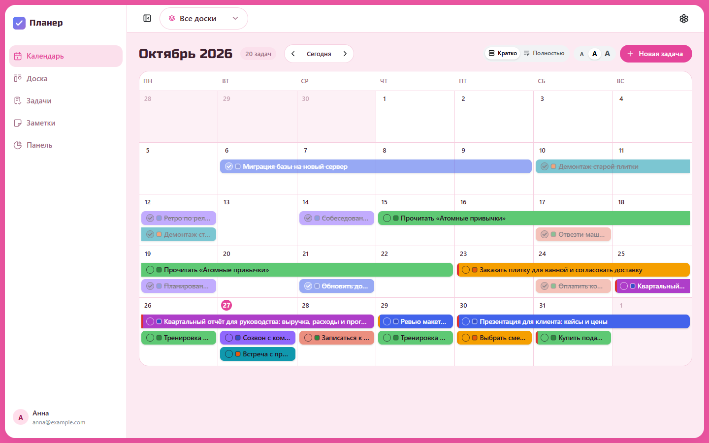
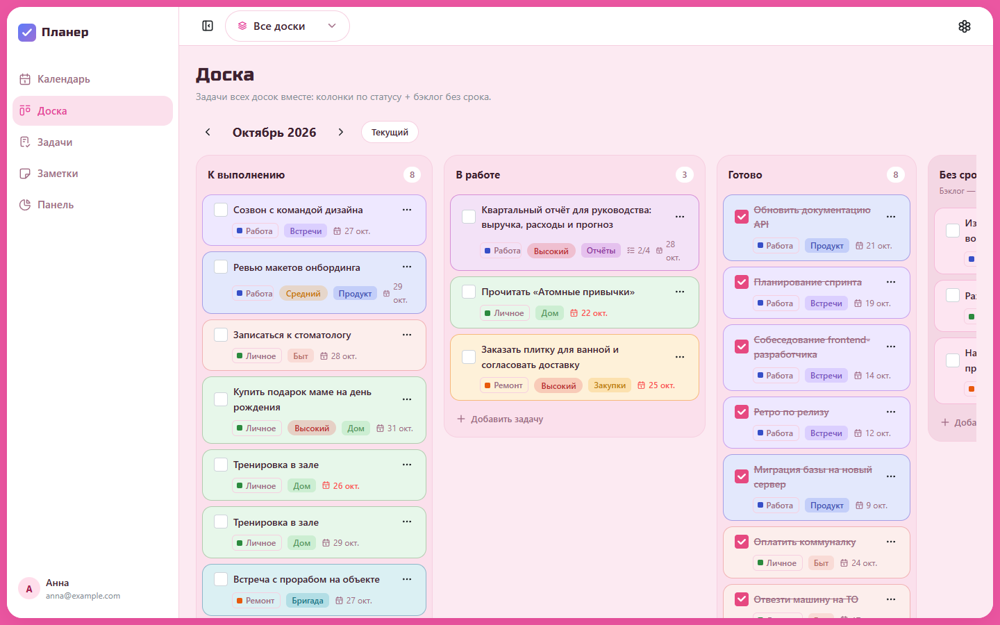
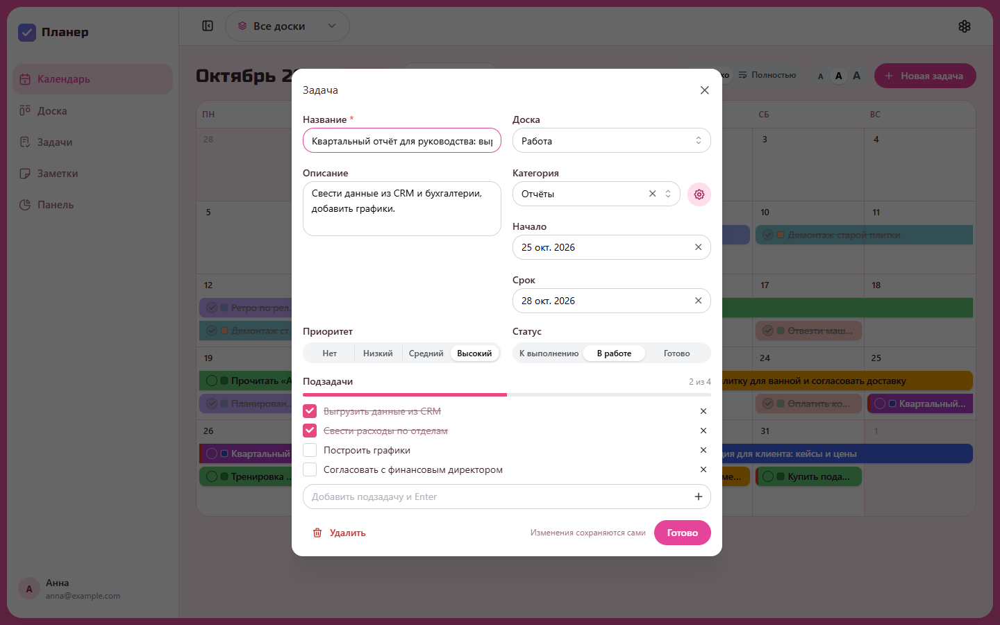
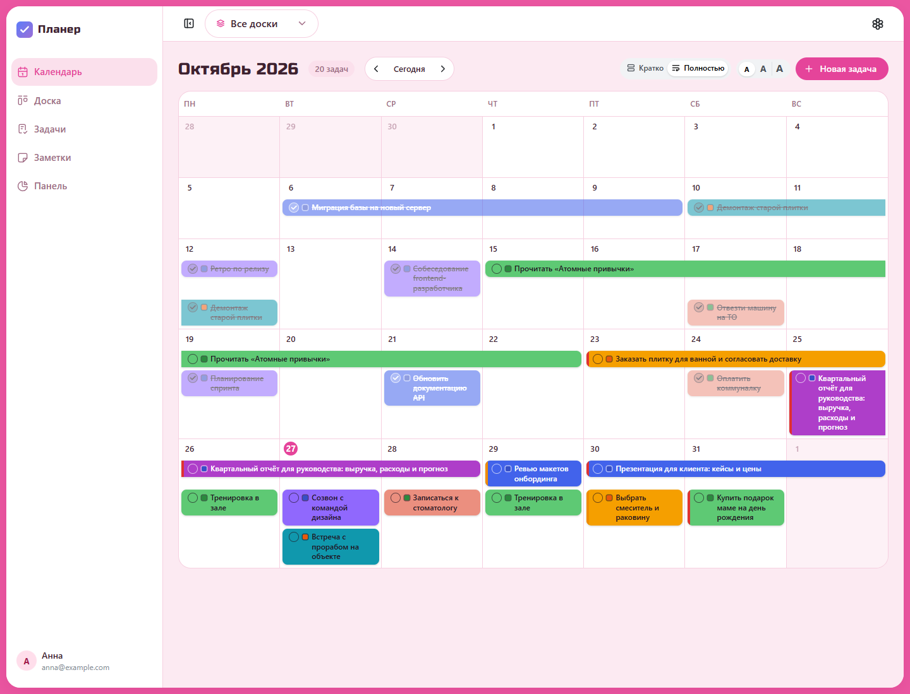
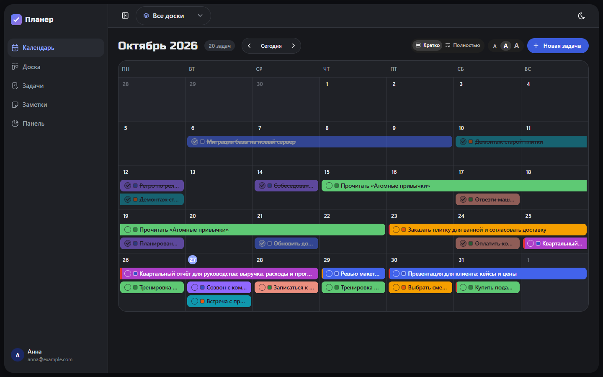
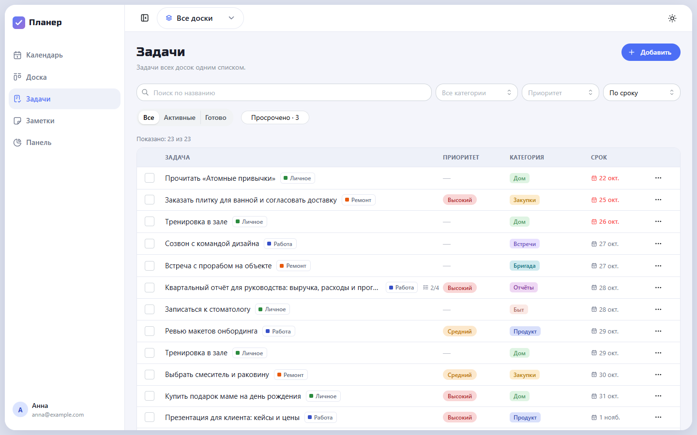
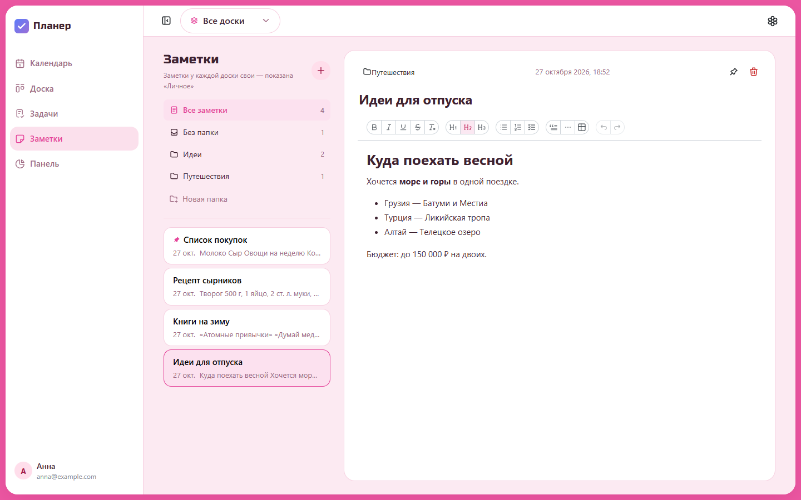
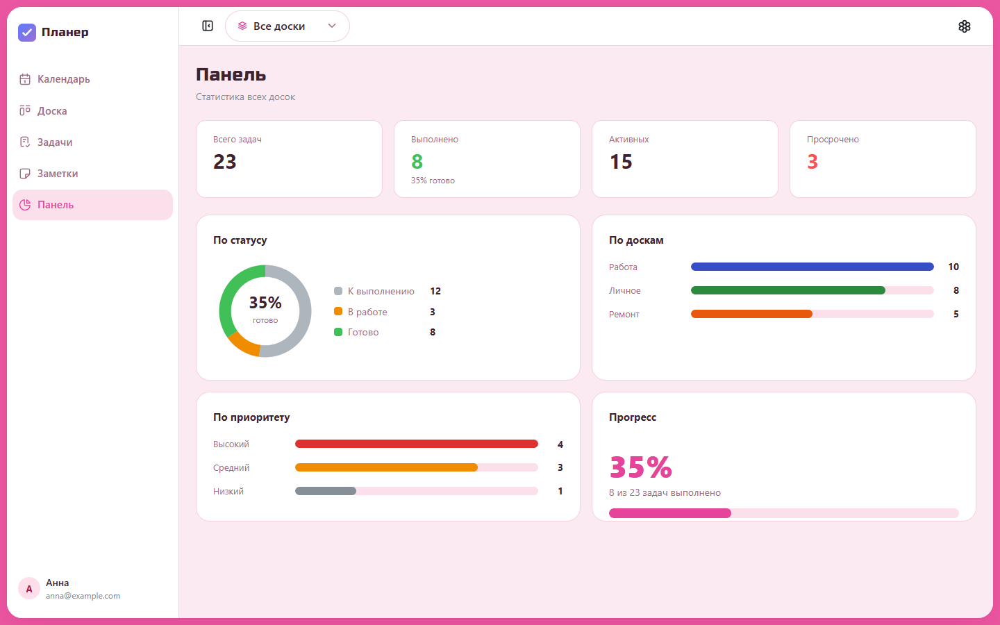
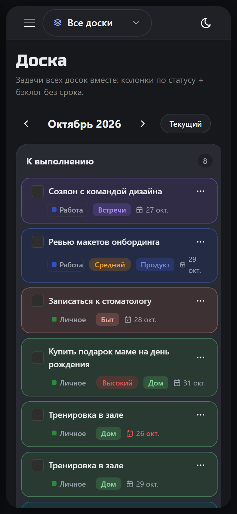
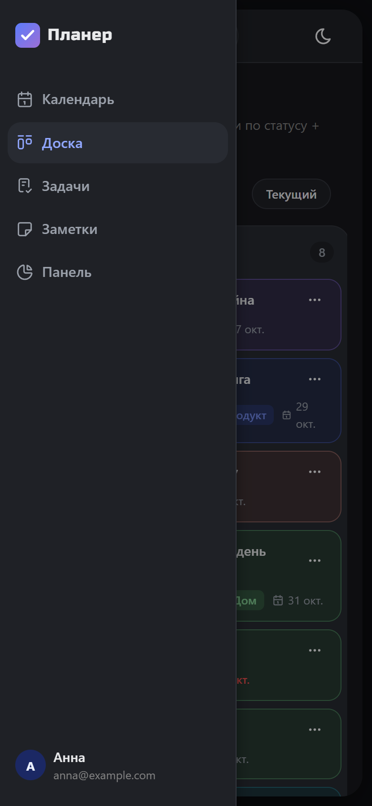

# Планер

Личный аналог Asana: **календарь + доска (канбан) + список задач + заметки + панель со статистикой**.
Задача — единая сущность: одна запись видна в календаре, на доске и в списке.
Работа, личное, ремонт — на отдельных досках, а «Все доски» показывает всё вместе.
Данные хранятся в PostgreSQL, у каждого пользователя свои.

Приложение работает локально — весь стек поднимается одной командой в Docker
(см. [«Запуск в одну кнопку»](#локальный-запуск-в-одну-кнопку)).



## Возможности

- **Календарь на месяц** — многодневные задачи полосами, перетаскивание между днями,
  быстрое добавление кликом по дню. Режим «Полностью» показывает название задачи
  целиком, размер шрифта переключается (A / A / A).
- **Доска** — колонки по статусу за выбранный месяц + бэклог без срока, drag-and-drop.
- **Список задач** — поиск, фильтры по категории, приоритету и статусу, просроченные.
- **Доски по темам** — у каждой свои задачи, категории и заметки; пункт
  **«Все доски»** собирает задачи всех досок с цветной меткой доски.
- **Задача** — описание, категория, приоритет, даты начала и срока, подзадачи
  с прогрессом; изменения сохраняются сами, задачу можно перенести на другую доску.
- **Заметки** — rich-text (заголовки, списки, чек-листы, таблицы), папки,
  перетаскивание заметок между папками, закрепление.
- **Панель** — статистика по статусам, доскам/категориям и приоритетам.
- **Горячие клавиши над карточкой**: `Ctrl+C` / `Ctrl+V` — копия задачи,
  `Delete` — удалить (с отменой), `C` — выбрать категорию.
- **Три темы** — розовая, светлая и тёмная.

## Скриншоты

| | |
| --- | --- |
|  **Доска** — канбан по статусам и бэклог |  **Задача** — свойства, подзадачи, выбор доски |
|  **Календарь, режим «Полностью»** |  **Тёмная тема** |
|  **Список задач** (светлая тема) |  **Заметки** с папками |
|  **Панель** со статистикой | |

**На телефоне** — доска и боковое меню (тёмная тема):

<p>
  
  &nbsp;
  
</p>

Скриншоты снимаются автоматически на демо-данных (реальные данные не участвуют):
`cd frontend && npm run screenshots` → `docs/screenshots/`.

## Стек

| Слой | Технологии |
| --- | --- |
| Frontend | React 19 + TypeScript + Vite, Mantine (UI), SCSS-модули, Zustand, React Router, dnd-kit, Tiptap (заметки) |
| Backend | Django 5 + Django REST Framework, gunicorn, WhiteNoise |
| БД | PostgreSQL |
| Тесты | Django TestCase · Vitest + Testing Library · Playwright (e2e) |
| Линтеры | oxlint (+ jsx-a11y), Prettier, Stylelint (front) · Ruff, Black (back) |

## Структура

```
calendar/
├─ frontend/                 React-приложение
│  ├─ src/
│  │  ├─ components/         layout (сайдбар, переключатель досок, темы) и общие UI
│  │  ├─ features/           calendar, board, todo, notes, dashboard, auth, data
│  │  ├─ store/              Zustand-сторы (данные с API, оптимистичные правки с откатом)
│  │  ├─ lib/                api-клиент, resources (запросы + маппинг)
│  │  └─ styles/             SCSS-токены и глобальные стили
│  ├─ e2e/                   Playwright: e2e-тесты и сценарий скриншотов
│  └─ Dockerfile · nginx.conf   сборка фронта (nginx + SPA-фолбэк + прокси /api)
├─ backend/                  Django-проект
│  ├─ config/                настройки, urls (DRF-роутер)
│  ├─ apps/                  accounts, workspaces, tasks, notes
│  └─ Dockerfile             образ бэкенда (gunicorn)
├─ docs/screenshots/         скриншоты для README
├─ docker-compose.local.yml  локальный стек «в одну кнопку» (порт 3000)
├─ docker-compose.yml        Postgres для разработки (порт 5433)
└─ .github/workflows/ci.yml  CI: линтеры, типы, тесты (бэкенд, фронт, e2e), сборка
```

## Локальный запуск «в одну кнопку»

Весь проект (БД + бэкенд + фронт) одной командой, без `.env` и ручных шагов.
Нужен запущенный Docker Desktop.

```bash
docker compose -f docker-compose.local.yml up -d --build
```

Открыть: <http://localhost:3000>. Админка Django: <http://localhost:3000/admin/>.

Дальше в **Docker Desktop** проект `calendar` появится в списке — запуск/остановка
кнопками ▶/⏹. Пересобирать (`--build`) нужно только после изменений кода.
`restart: unless-stopped` поднимает контейнеры автоматически при старте Docker Desktop.

### Данные и бэкап

Данные лежат в томе Docker `calendar_planner-localdata`. Пересборка и перезапуск
их не трогают; удаляет данные только `docker compose ... down -v` (флаг `-v`).
Имя проекта (`name: calendar`) и тома менять нельзя — иначе приложение
откроется с пустой базой.

```bash
# бэкап
docker exec calendar-db-1 pg_dump -U planner planner > backup.sql
# восстановление в чистую базу
docker exec -i calendar-db-1 psql -U planner planner < backup.sql
```

Дампы (`*.sql`) в git не попадают — храни их вне репозитория.

## Запуск для разработки

**1. База данных:**

```bash
docker compose up -d
```

**2. Backend:**

```bash
cd backend
python -m venv .venv
.venv\Scripts\activate            # Windows
pip install -r requirements.txt -r requirements-dev.txt
copy .env.example .env            # при первом запуске
python manage.py migrate
python manage.py createsuperuser  # создаст пользователя + сид (доски, категории)
python manage.py runserver
```

API: <http://localhost:8000/api/health/> · Админка: <http://localhost:8000/admin/>

**3. Frontend:**

```bash
cd frontend
npm install
npm run dev
```

Приложение: <http://localhost:5173> (запросы к `/api` проксируются на Django).

## Тесты и проверки

```bash
# Бэкенд (SQLite, Postgres не нужен)
cd backend
DATABASE_URL=sqlite:///test-db.sqlite3 python manage.py test
ruff check apps config

# Фронт: unit + компоненты
cd frontend
npm test
npm run typecheck && npm run lint

# E2E: сам поднимает Django (:8001, своя SQLite) и Vite (:5174)
cd frontend
npm run e2e
```

Локально e2e использует установленный Chrome; без него —
`npx playwright install chromium`. Всё это же запускает CI на каждый PR.

## Развёртывание на сервере (необязательно)

Сейчас приложение живёт локально. Для сервера в репозитории остались
`docker-compose.prod.yml` (Postgres + Django/gunicorn + фронт на nginx) и оверлей
`docker-compose.https.yml` с Caddy (автоматический HTTPS от Let's Encrypt).

1. Рядом с `docker-compose.prod.yml` создай `.env` с прод-значениями
   (см. блок PRODUCTION в `backend/.env.example`): `SECRET_KEY` (обязателен —
   без него бэкенд не стартует), `POSTGRES_PASSWORD`, `ALLOWED_HOSTS`,
   `CORS_ALLOWED_ORIGINS`, `CSRF_TRUSTED_ORIGINS`.
2. В `Caddyfile` укажи свой домен вместо `example.com`.
3. Запуск:

```bash
docker compose -f docker-compose.prod.yml -f docker-compose.https.yml up -d --build
```

Открытые порты: 80 и 443 (Caddy). Цепочка: Caddy → nginx (фронт, `/api`,
`/admin`) → Django; `X-Forwarded-Proto` пробрасывается, поэтому редирект на
https не зацикливается.
